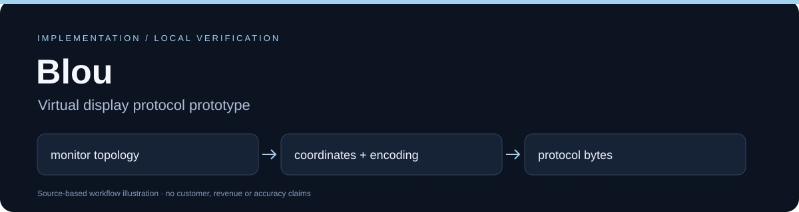

# Blou

Blou is a pre-alpha Python project exploring **virtual multi-monitor support for a phone-sized RDP client**. The idea: the RDP client declares its monitor layout to the server, so a client can declare several virtual monitors and then let the user pan between them on a small screen.

**Status: early prototype.** What exists and is tested is a pure-Python protocol/geometry core and a Windows-only local desktop-capture workbench. There is **no working Android/RDP client** in this repository. The FreeRDP integration is a design plus two patches (see [Limits](#limits)).

The Rust-first workspace now implements `blou-core` geometry, viewport/swipe mapping and fingerprint-policy parity: all 27 portable reference cases have Rust counterparts and golden vectors. Python remains the executable reference. `blou-rdp` pinning is tested with synthetic certificate fixtures and in-memory TLS, including a trusted-root mismatch control. Display-control bytes for 1–4 monitors match pinned IronRDP; odd widths are rejected. Real RDP/Android integration remains pending. IronRDP is the preferred future engine, with FreeRDP retained as fallback. Cargo-deny reports duplicate versions of seven upstream dependency families as warnings (owner decision; no exceptions). See [the Rust port plan](docs/RUST_PORT.md).



## What is in the box

| Path | What it does | Tested |
|------|--------------|--------|
| `src/blou/layout.py` | Virtual monitor layouts (horizontal row, 2x2 grid) and validation | unit tests |
| `src/blou/viewport.py` | Maps phone touch coordinates to a composite desktop, swipe navigation, damage-rect clipping | unit tests |
| `src/blou/dvc.py` | Encodes RDP display-control (MS-RDPEDISP) capability and monitor-layout PDUs | unit tests (byte layouts) |
| `src/blou/security.py` | Certificate fingerprint pinning check; a policy manifest only (no Android Keystore code) | unit tests (synthetic data) |
| `src/blou/desktop.py`, `scripts/blou_desktop.py` | Windows local loopback screen-preview workbench (consent gated, bearer token) | unit tests with fixtures; real capture only verified manually on Windows 11 |
| `patches/`, `scripts/*phase0*` | FreeRDP experiments (fabricated monitor layout for `xfreerdp`) | not run in CI; see Limits |

The protocol core uses only the Python standard library.

## Quick start

Requires Python 3.10+ (this workspace gate also verified on 3.12), `git`, Rust via rustup (pinned to 1.94.1), and network access once for setup.

```bash
git clone https://github.com/grloper/Blou.git
cd Blou
scripts/setup.sh        # creates .venv, installs the project and pinned dev tools
scripts/verify.sh       # the single gate: Python checks, offline demo, package build, Rust fmt/clippy/tests
```

Run just the tests:

```bash
source .venv/bin/activate
python -m unittest discover -s tests -v
```

Run the synthetic demo (no RDP or TLS connection; rewrites `docs/verification/local-core-demo.json`):

```bash
python scripts/demo_local.py
```

Use as a library:

```bash
pip install -e .
python -c "from blou.layout import LayoutBuilder; print(LayoutBuilder.create_horizontal_row(count=3).bounding_width)"   # 5760
```

The Windows workbench is described in [docs/WINDOWS-WORKBENCH.md](docs/WINDOWS-WORKBENCH.md) (`pip install -e .[desktop]`).

## Limits

- No Android client build, native FreeRDP integration, physical phone, real TLS session or real multi-monitor RDP session has been exercised by the automated tests.
- The `FreeRDP` submodule is pinned to upstream 3.31.1 (`63b948ca5`) and is optional (`scripts/setup.sh --with-freerdp`). `patches/0001-*` applies to that commit; `patches/0002-*` (Android CMake fixes) **does not apply cleanly** to it yet (tracked in [docs/ROADMAP.md](docs/ROADMAP.md)).
- Design documents (`SPEC.md`, `ARCHITECTURE.md`, `docs/SECURITY_ARCHITECTURE.md`, `docs/PROTOCOL_INSIGHTS.md`) describe intent. Treat their claims as unverified unless backed by code and a test. IP addresses in them are placeholders.
- Evidence and its limits: [docs/verification/README.md](docs/verification/README.md).

## Project docs

[ROADMAP](docs/ROADMAP.md) · [CONTRIBUTING](CONTRIBUTING.md) · [SECURITY](SECURITY.md) · [CHANGELOG](CHANGELOG.md) · [AGENTS.md](AGENTS.md) (instructions for AI coding agents)

## License

Apache License 2.0, see [LICENSE](LICENSE). FreeRDP (the optional submodule, also Apache-2.0) is a separate work under its own license and is not included in the Python package.
